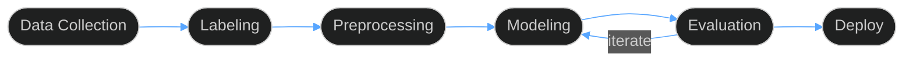

<div align="center">


<br/>

<a href="https://www.linkedin.com/in/minh-nguy%E1%BB%85n-004922239/">
  
</a>
<a href="https://www.facebook.com/ndm2k2">
  
</a>


</div>

<br/>

<div align="center">
  
</div>

---

## $\lambda$ About Me 

```python
from dataclasses import dataclass, field

@dataclass
class Minh:
    role: str = "AI Engineer"
    country: str = "Vietnam 🇻🇳"
    languages: list = field(default_factory=lambda: ["Python", "C++"])
    focus: list = field(default_factory=lambda: [
        "Computer Vision", "Object Detection", "Deep Learning"
    ])

    def mission(self) -> str:
        return "minimize loss, maximize learning"

if __name__ == "__main__":
    print(Minh().mission())
```

Mục tiêu tối ưu hoá của mình:

$$
\theta^{*} = \arg\min_{\theta} \; \frac{1}{N} \sum_{i=1}^{N} \mathcal{L}\big(f_{\theta}(x_i),\, y_i\big) + \lambda \lVert \theta \rVert_2^2
$$

$$
\theta_{t+1} = \theta_t - \eta \, \nabla_{\theta} \mathcal{L}(\theta_t)
$$

> *"Mathematics is the language in which the universe is written."*

---

## $\sum$ Tech Stack

<div align="center">


<br/><br/>


<br/><br/>


</div>

| Lĩnh vực | Chi tiết |
|:---|:---|
| 🗂️ **Data** | Thu thập, gán nhãn, tiền xử lý dữ liệu ảnh |
| 🧠 **Modeling** | Phân loại, hồi quy, phát hiện đối tượng |
| 🛠️ **IDE** | PyCharm, Google Colab, Jupyter Notebook |

---

## $\int$ Workflow



---

## $\nabla$ GitHub Stats

<div align="center">


<br/>


<br/><br/>


<br/>


</div>

---

<div align="center">

$$e^{i\pi} + 1 = 0$$


</div>
