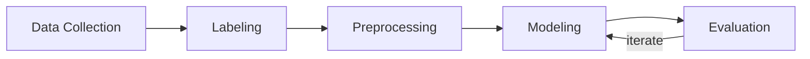

<div align="center">


<br/><br/>

<a href="https://www.linkedin.com/in/minh-nguy%E1%BB%85n-004922239/">
  
</a>
<a href="https://www.facebook.com/ndm2k2">
  
</a>

</div>

---

## $\lambda$ About Me

```python
class Minh:
    role      = "AI Engineer"
    location  = "Vietnam"
    languages = ["Python", "C++"]
    focus     = ["Computer Vision", "Deep Learning"]

    def goal(self):
        return "minimize loss, maximize learning"
```

Mục tiêu tối ưu hoá của mình:

$$
\theta^{*} = \arg\min_{\theta} \; \frac{1}{N} \sum_{i=1}^{N} \mathcal{L}\big(f_{\theta}(x_i),\, y_i\big)
$$

> *"Mathematics is the language in which the universe is written."*

---

## $\sum$ Skills

| Lĩnh vực | Công cụ |
|---|---|
| **Languages** |   |
| **Deep Learning** |    |
| **ML & Vision** |   |
| **Data & Math** |    |
| **App / Backend** |   |
| **IDE** |    |

---

## $\int$ What I Do

- **Data** — Thu thập, gán nhãn và tiền xử lý dữ liệu ảnh.
- **Modeling** — Xây dựng mô hình phân loại, hồi quy và phát hiện đối tượng.



---

## $\nabla$ My Stats

<div align="center">


<br/>


</div>

---

<div align="center">

$e^{i\pi} + 1 = 0$


</div>
