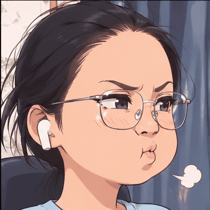

  <!-- Giữ nguyên GIF 1 -->
  

  <!-- Dòng chạy chữ phong cách thuật toán & tối ưu hóa -->
  <h1>
    
  </h1>

  

    
    
  

---

### $\mathcal{A}$bstract — About Me

I am an **AI Engineer & Researcher**  from **Vietnam**, working at the intersection of **Applied Mathematics**, **Computer Vision**, and **Deep Learning**. My work focuses on formulating real-world visual perception problems into rigorous mathematical optimization frameworks.

> **Core Objective:**
> $$\min_{\theta \in \Theta} \; \mathbb{E}_{(x, y) \sim \mathcal{D}} \big[ \mathcal{L}\big(f_\theta(x), y\big) \big] + \lambda \mathcal{R}(\theta)$$

- **$\Omega_1$ — Data Representation & Manifold Learning:** Collecting, annotating, and preprocessing high-dimensional image and spatio-temporal datasets ($x \in \mathbb{R}^{H \times W \times C}$).
- **$\Omega_2$ — Statistical Modeling & Neural Architectures:** Designing, training, and analyzing deep models for classification, regression, and object detection.
- **$\Omega_3$ — Mathematical Foundations:** Linear Algebra, Probability & Statistics, Multivariate Calculus, Convex & Non-Convex Optimization, and Information Theory.

---

### $\Sigma$ — Computational Stack & Environments

| Domain | Tools & Frameworks |
| :--- | :--- |
| **Languages** |   |
| **Deep Learning & Vision** |     |
| **Scientific Computing & ML** |     |
| **Deployment & GUI** |   |
| **Research Environments** |    |

---

 

  <!-- Giữ nguyên GIF 3 của bạn, đóng khung như một trạng thái hội tụ/debug của mô hình -->
  
   
  <i>Fig 1. When the loss function refuses to converge at 3:00 AM ($\nabla_\theta \mathcal{L} = \text{NaN}$).</i>

 

---

### $\mathcal{E}$mpirical Metrics — GitHub Stats

  
   
  

